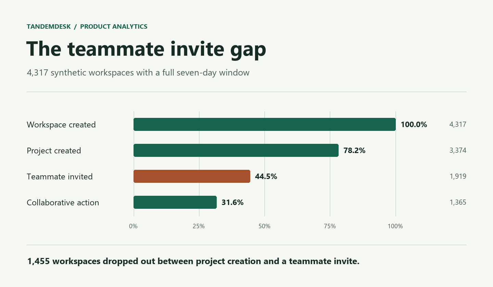

# Product Growth & Retention Intelligence

**TandemDesk · Synthetic SaaS case study**

Where should a growth team investigate onboarding first, and how long would it take to test a fix? This project follows 4,532 fictional workspaces through 46,002 events from signup to collaboration, repeat usage and payment.

| Finding | Evidence |
| --- | --- |
| Invite is the largest onboarding drop | 1,455 of 3,374 project creators did not reach the invite step by day 7 |
| First-week activation is associated with repeat usage | Week-4 return usage was 45.8% among early activators and 17.8% among other eligible workspaces |
| An invite prompt is testable, with a substantial enrollment window | At simulated traffic, detecting a five-point lift takes 1,520 workspaces per arm and 19 weeks of enrollment, plus follow-up |

All results come from the included simulation. The randomized experiment is proposed. Read the [case study](docs/case-study.md) for the decision and its limitations.



## Open the dashboard locally

Install [Python 3.12](https://www.python.org/downloads/) if it is missing. On Windows, open the extracted project folder in File Explorer, type `powershell` into its address bar, and press Enter. Run these commands one at a time.

```powershell
py -3.12 -m venv .venv
.\.venv\Scripts\python.exe -m pip install -r requirements.txt
.\.venv\Scripts\python.exe -m streamlit run app.py
```

Open [http://localhost:8501](http://localhost:8501) if your browser does not open automatically. Keep the PowerShell window open while using the dashboard. Press Ctrl+C there to stop it. If `py` is unavailable and `python --version` reports 3.12, use `python -m venv .venv` for the first command.

On macOS or Linux, run `python3.12 -m venv .venv`, then substitute `.venv/bin/python` for the Windows Python path in the remaining commands.

- **Onboarding** shows the ordered funnel and the largest drop in the current selection.
- **Retention** shows weekly signup cohorts and compares week-4 use by early activation.
- **Segments** compares channel or team size across activation, retention and monetization.
- **Experiment** estimates sample size and enrollment time as you change the detectable lift or traffic share. Its planning baseline uses all channels and team sizes.

The app reads the included data. Running locally requires no API keys or paid services.

## Reproduce the results

Use the same Python executable from setup in place of `python` below if your virtual environment is not activated. The generator, SQLite loader and report run with the Python standard library. Dashboard checks require the installed packages.

```bash
python -m growth.generate
python -m growth.warehouse tandemdesk.sqlite
python -m growth.report --output results
python -m unittest discover -s tests -v
```

The loader creates a new SQLite file. Use a fresh filename on subsequent runs. Run the numbered analysis queries in `sql/` in a SQLite client once the database exists. The report command also executes them against an in-memory database and writes separate SQL and Python CSVs. The tests reconcile the funnel, cohort cells, segments, cash and activation diagnostic, and exercise filters and navigation in the Streamlit app. GitHub Actions runs the tests on Python 3.12.

## Project files

| Path | Contents |
| --- | --- |
| [data/](data/) | Workspaces, compressed raw events and the snapshot manifest |
| [growth/](growth/) | Data generator, analysis, sample-size calculator and SQLite loader |
| [sql/](sql/) | Workspace outcomes view and four queries |
| [results/](results/) | Published baseline, Python and SQL exports |
| [app.py](app.py) | Streamlit dashboard |
| [tests/](tests/) | Data, reconciliation, boundary and dashboard checks |
| [Business requirements](docs/business-requirements.md) | Decision, stakeholders and acceptance criteria |
| [Data dictionary](docs/data-dictionary.md) | Event taxonomy, simulation and metric rules |
| [Experiment protocol](docs/experiment.md) | Eligibility, assignment, instrumentation, power and decision rules |
| [Portfolio handoff](docs/portfolio.md) | Copy, assets and link targets for a future project page |
